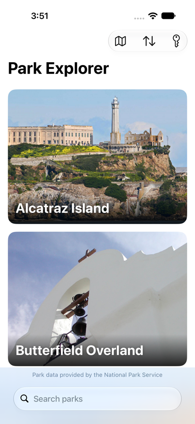
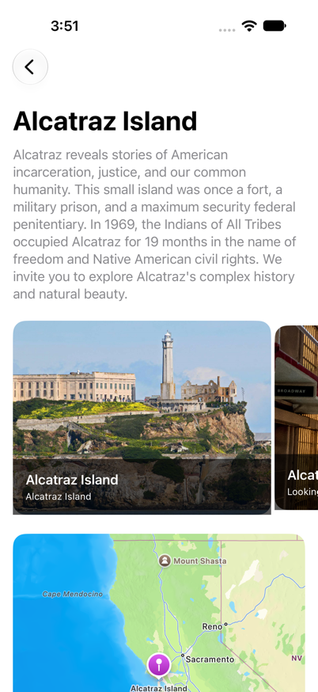

# Park Explorer

Park Explorer is a native iOS app for discovering sites managed by the U.S. National Park Service. Browse parks by state, search and sort the results, explore official photography, and view each park's location on an interactive map.

## Highlights

- Current park information from the National Park Service API
- State-based browsing across all 50 states and Washington, D.C.
- Search by park name and alphabetical sorting
- Image-focused park cards and a paging photo gallery
- Park descriptions and locations presented with MapKit
- Pull-to-refresh plus clear loading, empty, and error states
- API credentials protected in the iOS Keychain
- Adaptive SwiftUI interface for iPhone and iPad
- VoiceOver labels and Dynamic Type-friendly system typography

## Screenshots

  
  

## Requirements

- iOS 17.0 or later
- Xcode 16 or later
- A free [National Park Service API key](https://www.nps.gov/subjects/developer/get-started.htm)

## Getting Started

1. Clone the repository.
2. Open `My Parks App.xcodeproj` in Xcode.
3. Select the **My Parks App** scheme and an iPhone or iPad simulator.
4. Build and run the app.
5. Tap the key icon, enter your NPS API key, and tap **Done**.

The API key is saved only to the local device Keychain and is never committed to source control.

## Architecture

Park Explorer uses a lightweight SwiftUI architecture:

- `ParksAPIClient` creates and performs asynchronous NPS API requests with `URLSession`.
- `ParksViewModel` owns loading state and prepares filtered, sorted park data for the interface.
- Codable models map the API response into strongly typed Swift values.
- Focused SwiftUI views render the park list, photo gallery, details, and map.

The project uses Swift concurrency and the Observation framework without third-party dependencies.

## Testing

The Swift Testing suite covers:

- NPS response decoding
- Case-insensitive park searching
- Full-name searching
- Ascending and descending sorting

Run tests with **Product → Test** in Xcode.

## Privacy

Park Explorer does not include analytics, advertising SDKs, or user accounts. The app sends the selected state and the user's API key directly to the National Park Service API. The key is stored locally in the iOS Keychain using a device-only accessibility class.

## Data and Attribution

Park information and photography are provided by the [National Park Service](https://www.nps.gov/). Park Explorer is an independent project and is not affiliated with or endorsed by the National Park Service or the U.S. Department of the Interior.

## Technology

Swift, SwiftUI, MapKit, Foundation, URLSession, Swift Concurrency, Observation, Security, and Swift Testing.
